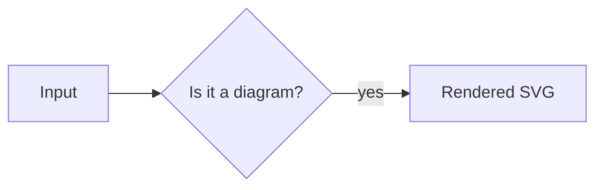

# dsh-mermaid

A [DeepSeek Harness](https://github.com/deepseek-ai) Web UI plugin that turns
fenced ```` ```mermaid ```` code blocks in the chat into inline diagrams. The
original Mermaid source stays one click away.

- Inline SVG rendered by [Mermaid](https://mermaid.js.org/) 12 inside the page —
  no CDN, no extra HTTP route, no external service.
- Theme-aware: the palette is derived from the DSH design tokens, and a
  post-render contrast pass repairs diagram colors that would sink into the card.
- Designed to sit in the chat: a rounded figure card with a quiet toolbar, hover
  state, reveal animation and Mermaid's modern `neo` look.
- Large diagrams stay usable: bounded inline height, an *Open full screen* viewer
  with fit-screen / fit-width / actual-size presets, zoom, pan and keyboard
  shortcuts.
- Localized (English / 中文) through the DSH Client locale service.
- Streaming-aware: a block that changes while the answer streams re-renders when
  its text settles, and a block that cannot parse falls back to plain code.

## Requirements

- DeepSeek Harness desktop with the Web UI and the `plugin_manager` plugin
  (bundled with the desktop app).
- Verified with **DSH desktop 0.2.2-rc.1**. The plugin looks at the Markdown
  code-block DOM and the Client `theme` / `locale` services, so a DSH release
  that changes those internals may need a plugin update.

## Install

Inside a DSH session:

1. Install the bundle from the package registry:

   ```
   plugin_manager  action = install_bundle
                   target = @cyua/dsh-mermaid
   ```

   For an internal registry, publish it first (see [Publishing](#publishing)) or
   install straight from a checkout directory:

   ```
   plugin_manager  action = install_bundle
                   target = <path-to-checkout>
   ```

2. The Loader patch adds the row `cyua-mermaid-render`. Enable it in the plugin
   list (or with `plugin_manager action = set_plugin`) if it is not enabled yet.
3. Reload the page if the diagrams do not appear yet — the Client module is
   loaded at page boot.

To upgrade, install the new version and reload; to remove, use
`plugin_manager action = remove_bundle target = @cyua/dsh-mermaid`.

## Usage

Write a normal fenced block:

````markdown

````

The rendered figure has a toolbar with:

- the detected diagram family (`时序图`, `流程图`, `类图`, …),
- **copy source** (shows a check mark when copied),
- **actual size / fit width** (only when the diagram is wider than the card),
- **open full screen**, and
- **view source / view diagram**.

In the full-screen viewer: `−  100%  +`, *fit screen*, *fit width*,
*actual size*, close; `Esc` closes, `+`/`-` zoom, `0` fits, scrollbars pan.

## Development

```powershell
git clone https://github.com/Cyua/dsh-mermaid.git
cd dsh-mermaid
npm install          # mermaid + esbuild (dev only)
npm run build        # release build -> dist/client.js
npm run verify       # checks the artifact before publishing
```

`dist/` is generated and git-ignored; `npm install` / `npm pack` / `npm publish`
build it automatically through the `prepare` script.

Install the local checkout into your profile to try changes:

```
plugin_manager  action = install_bundle
                target = <path-to-checkout>
```

After rebuilding, reload the Client module by disabling and re-enabling the
`cyua-mermaid-render` row (or restart DSH): the page pins the module generation
it booted with, so a changed file is not picked up on its own.

`dev/verification/` contains a loopback verification harness (a report server
plus a temporary observer plugin) used to check the plugin inside the running
Web UI; it is not part of the published package.

## Publishing

The package is a normal npm package with DSH bundle metadata (`dsh.bundle.patch`
and `dsh.client` in `package.json`). There is no separate plugin archive format.

1. Update `version` in `package.json` and add a `CHANGELOG.md` entry.
2. `npm run check` (syntax + build + artifact check).
3. `npm pack --dry-run` to review the file list and size (~5 MB, Mermaid is
   bundled).
4. Publish to the internal registry (needs an account/scope allowed to publish
   `@cyua`):

   ```powershell
   npm publish --registry <your-internal-registry> --access restricted
   ```

   If the `@cyua` scope does not exist on the registry yet, register it or rename
   the package (`name` in `package.json` and in `cordis.patch.yml`; the Client
   module id is derived from `package.json` automatically).

The release build compiles out every diagnostic call site, and `npm run verify`
fails if the artifact still contains local reporter strings or is not in the DSH
module-loader format. Do not publish a `--debug` build.

## Design notes

### Look and feel

The figure is a card that matches the surrounding UI instead of a raw `<svg>`:

- **Toolbar.** A small hexagon mark plus the diagram family on the left; icon
  buttons on the right (copy source, fit/actual size, full screen, source).
  Buttons are dimmed until the card is hovered or focused.
- **Card.** 16 px corner radius (from `--dsw-radius-lg`, plus `corner-shape` when
  supported), a hairline border (`--dsw-alias-border-l1`), a faint top sheen, and
  a border/shadow lift on hover.
- **Canvas.** Generous padding, centered content, thin scrollbars plus an edge
  mask when a diagram scrolls, and a 220 ms fade/slide-in.
- **Diagram surface.** Mermaid's `neo` look with `base` theme variables taken
  from the DSH aliases; 9 px rounded corners on actors, notes, loop labels and
  `rect` sections; accent-tinted notes and activations; 1.1 px connectors; a
  single soft drop shadow instead of Mermaid's hard offset emboss.

### Readability

Mermaid's stock dark theme and diagram sources designed for a white page are the
two reasons a rendered diagram can look washed out on a dark card. The plugin
renders with the `base` theme and fills every diagram variable from the DSH
aliases (`--dsw-alias-bg-layer-*`, `--dsw-alias-label-*`, borders, state colors),
read from the live page; a theme switch re-initializes and re-renders. Sources
often carry their own colors (`rect rgb(255,247,230)` bands, `box rgb(...)`
groups, `style` overrides) that assume dark ink on white: after rendering, a
surface that cannot carry the theme ink is re-tinted at the theme's lightness
with its hue preserved (a cream band becomes a dark warm band), and text that
still lands on a busy surface is given the best available ink. Comfortably
readable text is never touched.

### Large diagrams

- **Inline card** — the card width is respected: the SVG scales until it fits
  horizontally, and the canvas is height-bounded
  (`max-height: min(72vh, 720px)`) with its own scrollbars and edge fades. When
  the fitted scale drops below 0.62 (or the diagram is taller than the canvas), a
  floating **全屏查看 / Open full screen** pill appears; double-clicking the
  diagram does the same.
- **Full screen viewer** — a modal with the whole diagram: fit-screen scales both
  axes so the complete diagram is visible on one screen; zoom and scrollbars
  handle the details. The card's SVG is cloned, so the inline view is untouched.
  Both the card canvas and the viewer body use start-aligned flex with
  `margin: auto` on the SVG rather than flex centering, because a centered
  overflowing child puts its top/left edge beyond the scroll origin and makes the
  start of a zoomed diagram unreachable.

### How it works

The Web UI renders Markdown through shared primitives inside its shell bundle.
The code-block component (`md-code-block` wrapper with `data-code-block-banner` /
`data-code-block-content` children) is not exposed as a slot or a renderer
registry, so there is no official seat to plug a diagram renderer into. The
plugin observes the rendered DOM with a debounced `MutationObserver`, recognizes
Mermaid fences, and layers its figure next to the native code block. It never
reads or mutates another plugin's styles or components.

A fence is recognized by its banner language when that is `mermaid`, and
otherwise by content: a banner that is a concrete language (`bash`, `python`, …)
opts the block out; a generic localized label (`代码块` / `Code block`) leaves the
decision to the first diagram line (`flowchart`, `sequenceDiagram`,
`classDiagram`, `gantt`, …). A block whose code does not parse is restored
untouched.

## Repository layout

| Path | Role |
| --- | --- |
| `package.json` | The npm package and DSH bundle manifest (`dsh.bundle.patch`, `dsh.client`, `files`, scripts). |
| `cordis.patch.yml` | Loader patch that inserts the `cyua-mermaid-render` row. |
| `index.js` | Host half (empty `apply`): the plugin only needs the bundle row. |
| `src/client.js` | Client-half source: detection, render queue, figure UI, contrast repair, full-screen viewer, i18n. |
| `build.mjs` | esbuild pipeline: bundles Mermaid + source into `dist/client.js` in the DSH module-loader format. |
| `dist/client.js` | Built Client module (generated, git-ignored, published). |
| `locale/*.json` | Localized plugin title/description for the plugin list. |
| `icon.svg` | Plugin icon for the plugin list. |
| `tools/check-release.mjs` | Release artifact check used by `npm run verify`. |
| `dev/verification/` | Local verification harness (report server + observer plugin), not published. |

## Verification

Verified in the running Web UI by loading the real plugin into the app page and
driving it with a temporary observer plugin that injected known diagram sources
off-screen, then reading back the figure chrome and auditing the rendered SVG
(per-text contrast against the surface actually behind it), all on the release
build in the dark theme:

| Case | Result |
| --- | --- |
| Sequence with `rect rgb(255,247,230)` band, note, `alt` | 18 labels, min contrast **11.75**, 0 failures |
| State / class / flowchart / pie | 4–9 labels, min contrast 9.25–15.03, 0 failures |
| Large 6-participant sequence | inline 850×640 inside a 898 px canvas (true fit, no horizontal scrollbar); full screen fit 70%, zoom to 110% with scroll reach to the first row, `Esc` restores the page scroll |
| Figure chrome | type label, copy/fit/full-screen/source buttons, 34 px toolbar, 16 px radius, rounded shapes (`rx: 9px`), soft drop shadow |

Known verification limits: the live checks were run in the dark theme; the light
palette goes through the same token path but was not re-audited.

## Known limits

- **Bundle size.** Mermaid is bundled into the Client module (~5.4 MB), so the
  plugin is self-contained; the module is evaluated at page boot.
- **DOM coupling.** The code-block markup and the Client services used here are
  internal to DSH, not a public plugin API.
- **Source colors can be re-tinted.** A fill that cannot carry the theme text is
  moved to the theme's lightness (hue preserved); fills that already read well are
  left alone.
- **Mermaid `box` groups** cannot contain messages in Mermaid 12 (upstream parser
  behavior); only participant declarations belong in a `box`.
- **Full-screen zoom** is button/keyboard driven; wheel zoom and drag-to-pan are
  not implemented (panning uses the overlay's scrollbars).

## License

MIT. Mermaid is bundled under its own MIT license — see
[THIRD_PARTY_NOTICES.md](THIRD_PARTY_NOTICES.md).
